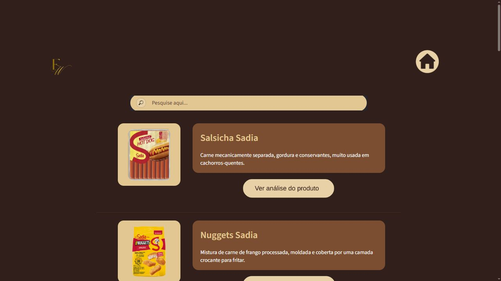

# Fake Wonka

Catálogo interativo de alimentos feito em Python para um trabalho de Introdução à Administração. O site reúne informações nutricionais, imagens e textos do grupo em uma interface com identidade visual própria.



Além do catálogo, há páginas sobre a proposta do trabalho, missão, visão, valores e organização da equipe.

## O que dá para explorar

- Consultar os 15 produtos da planilha e pesquisar pelo nome.
- Abrir a ficha de cada alimento, com imagem, tabela nutricional e os textos cadastrados pelo grupo.
- Visualizar o índice definido no trabalho em um gráfico de rosca.
- Navegar pelas páginas usando o estado de sessão do Streamlit.

A interface usa **Streamlit, HTML e CSS**; a leitura da planilha usa **pandas e openpyxl**, e o gráfico é feito com **Plotly**.

## Executar

Com Python 3.11 ou posterior, no PowerShell:

```powershell
git clone https://github.com/WmsTech/fake_wonka.git
cd fake_wonka
python -m venv .venv
.\.venv\Scripts\python -m pip install -r requirements.txt
.\.venv\Scripts\python -m streamlit run app.py
```

Execute os comandos na raiz do projeto: os caminhos da planilha e das imagens são relativos a essa pasta. O Streamlit informa o endereço local no terminal.

## Arquivos principais

| Arquivo ou pasta | Conteúdo |
| --- | --- |
| [`app.py`](app.py) | Páginas, navegação, busca e apresentação dos produtos |
| [`banco_alimentos.xlsx`](banco_alimentos.xlsx) | Base utilizada pela aplicação, incluindo índices e justificativas |
| [`cria_banco_dados.py`](cria_banco_dados.py) | Versão inicial do cadastro de produtos |
| [`imagens/`](imagens/) | Imagens dos alimentos |
| [`informacoes_nutricionais.pdf`](informacoes_nutricionais.pdf) | Material de consulta reunido para o trabalho |

O índice apresentado é uma proposta didática do grupo, armazenada na planilha e lida pelo site. Não é uma probabilidade clínica nem uma medida validada de segurança de um alimento. Os textos e as fontes nutricionais precisam de revisão antes de um uso além do contexto acadêmico.

**Atenção ao cadastro:** `cria_banco_dados.py` gera uma versão anterior da planilha, sem todos os campos da base atual e com índices zerados. Executá-lo na raiz sobrescreve a base usada pelo site.

## Equipe

Os papéis abaixo são os registrados na página “O Grupo”:

| Integrante | Participação |
| --- | --- |
| Danielle Cristine Tavera | Gerência de documentação |
| Misael Gomes da Silva | Gerência de desempenho |
| Ronald Rodrigues Barbosa | Liderança do grupo |
| Washington Marinho dos Santos | Gerência de tarefas e criação do site |

## O que pode melhorar

Padronizar os nomes das colunas nutricionais, atualizar o gerador para preservar a base atual e dar nomes acessíveis aos botões são os próximos ajustes mais úteis. A captura acima foi feita com a aplicação local em funcionamento.
